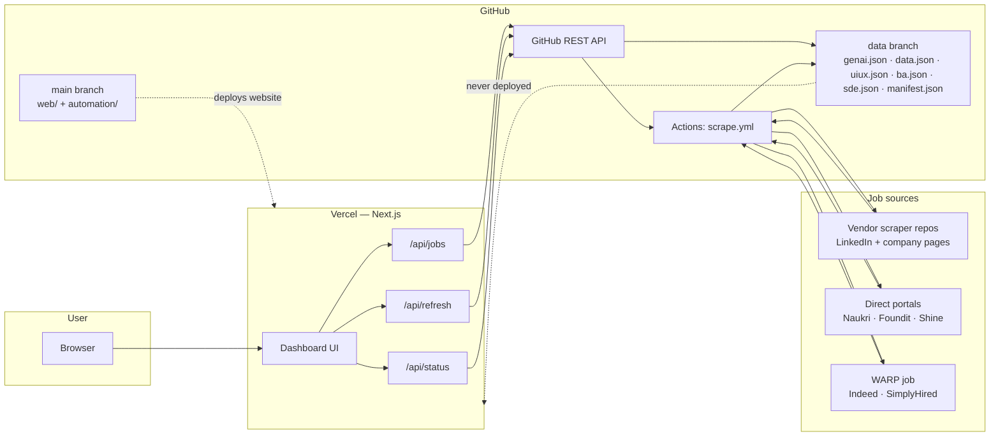
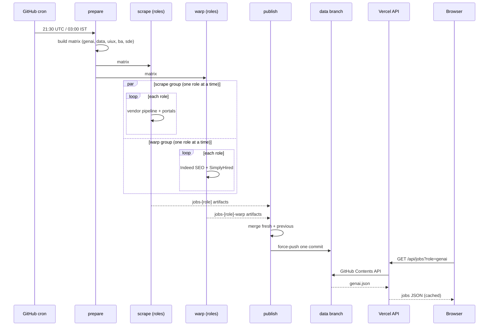
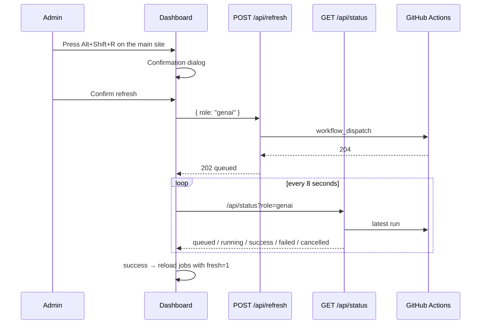

# Architecture — JobHunt Hub

A zero-cost, cloud-only job board for four role tracks:

- **GenAI / AI Engineering**
- **Data Engineering**
- **UI / UX Design**
- **Business Analyst** (entry-level first: fresher and 1–3 year roles rank above senior roles)

It aggregates jobs from Naukri, Foundit, Indeed, Shine, LinkedIn and company career pages, plus BA-specific sources (IIBA Career Center, Wellfound, Remote OK, We Work Remotely), publishes them as compact JSON, and serves them through a Next.js app on Vercel.

| Item | Value |
|---|---|
| Live site | <https://jobhunt-hub-web.vercel.app> |
| Repository | <https://github.com/Dilip457/jobhunt-hub> |
| Code branch | `main` |
| Data branch | `data` |
| Schedule | `30 21 * * *` UTC = **03:00 IST** daily |
| Hosting | Vercel (UI + API), GitHub Actions (scraping + publishing) |
| Database | None |
| Cost | ₹0/month on free tiers |

---

## 1. What the system does

1. Every morning, GitHub Actions runs the scraping workflow.
2. Four independent scrapers collect jobs for the four role tracks. Business Analyst reuses the UI/UX vendor pipeline with BA config and scoring, and adds its own portal and API sources.
3. The results are merged with the previous published data.
4. The merged JSON is force-pushed to an orphan `data` branch.
5. Vercel serves a Next.js UI and API routes that read that JSON.
6. An admin can reveal a hidden refresh control and run the same workflow on demand.

The scraper never runs on Vercel. The website never runs on the user's PC. Everything happens on GitHub's runners and Vercel's servers.

---

## 2. Design goals and non-goals

### Goals

- **Free to operate** — GitHub Actions + Vercel free tiers, no paid domain or database.
- **No PC dependency** — the daily pipeline runs entirely in the cloud.
- **No portal accounts or API keys required** — direct scrapers read public pages.
- **Fast page loads** — the UI reads cached JSON, not live portals.
- **Resilient publishing** — a failed or empty source must not blank the site.
- **Transparent dates** — each card shows when the job was posted on the portal and when this site first scraped it.
- **Single small data artifact** — JSON in the repo, no database.
- **Accessible by default** — the cinematic intro is optional; skip, reduced-motion, keyboard and WebGL fallbacks all reach the jobs.

### Non-goals

- Guaranteed real-time job data.
- Bypassing every anti-bot system permanently.
- Applying to jobs automatically.
- Collecting candidate PII or full job descriptions.
- Commercial use of scraped content.

---

## 3. High-level architecture



### Key separation

| Layer | Runs on | Responsibility |
|---|---|---|
| **UI** | Vercel | Render the cinematic role selection and job dashboards, filters, refresh panel |
| **API routes** | Vercel | Read JSON, dispatch workflow, poll run status |
| **Scraping** | GitHub Actions | Collect jobs from portals and vendor repos |
| **Publishing** | GitHub Actions | Merge, retain, write, force-push `data` |
| **Storage** | GitHub `data` branch | Compact JSON only |
| **Orchestration** | GitHub Actions | Cron + manual dispatch |
| **Auth** | GitHub PAT (server-side) | Read `data`, dispatch workflow, read run status |

---

## 4. Components

### 4.1 GitHub Actions — `scrape.yml`

The workflow has four job groups:

| Job | Purpose | Timeout | Parallelism |
|---|---|---|---|
| `prepare` | Build the role matrix (`genai`, `data`, `uiux`, `ba`, `sde`) | default | one job |
| `scrape` | Run the vendor pipeline + direct portal scrapers per role | 75 min per role | **1 role at a time** (`max-parallel: 1`) |
| `warp` | Run Indeed SEO + SimplyHired through Cloudflare WARP | 12 min per role | **1 role at a time**, `continue-on-error` |
| `publish` | Merge artifacts and force-push the `data` branch | default | one job, `if: always()` |

The `scrape` and `warp` groups both depend only on `prepare`, so GitHub may run them concurrently. Within each group, the roles run sequentially.

### 4.2 Scraper sources

| Source | How it is collected | Runs in |
|---|---|---|
| **LinkedIn** | Vendor repo's guest job search | `scrape` job |
| **Company career pages** | Vendor repo's company registry | `scrape` job |
| **Naukri** | Playwright + real Google Chrome | `scrape` job |
| **Foundit** | Public `/middleware/jobsearch` JSON endpoint | `scrape` job |
| **Shine** | Server-rendered HTML search pages | `scrape` job |
| **Indeed** | `curl_cffi` then Playwright; usually blocked on cloud IPs | `scrape` job (best effort) |
| **Indeed SEO** | Search-engine-style pages through WARP | `warp` job |
| **SimplyHired** | `curl_cffi` through WARP | `warp` job |
| **Optional APIs / ATS** | Adzuna, Jooble, JSearch, Remotive, Himalayas, Greenhouse/Lever/Ashby/SmartRecruiters | Local / opt-in only (`--no-apis` in cloud) |
| **IIBA Career Center** | Server-rendered search page (plain HTTP) | `scrape` job (BA only) |
| **Wellfound** | Embedded Apollo state in the role page | `scrape` job (BA only) |
| **Remote OK** | Public remote jobs API | BA API step |
| **We Work Remotely** | Public RSS feed | BA API step |

### 4.2.1 Business Analyst track

Business Analyst has no separate vendor repo. It reuses `Dilip457/UI-UX-Job_Hunt`, and
`run_source.py` patches that repo before its modules import:

- `config.SEARCH_KEYWORDS`, `SKILL_SEARCH_KEYWORDS` and `TARGET_ROLES` from `profiles/ba.json`
- `config.RESUME_PROFILE`, high/medium weight keywords and the role/tool scoring functions
- `scrapers.company_pages_scraper.DESIGN_KEYWORDS`, so BA titles survive its title filter

`api_sources.py` and `export.py` apply an **entry-level-first** score adjustment for `ba`:
fresher, entry-level, graduate, intern, junior, associate and 1–3 year titles get a boost;
senior, lead, principal, manager, director and head titles are pushed down. The dashboard
(`web/lib/utils.ts` → `experiencePriority()`) applies the same order when the role is `ba`
and the sort is `score`.

BA-only portal scrapers live in `portal_scrapers.py` (`iiba`, `wellfound`) and run inside the
normal `scrape` job. The workflow adds a BA-specific `api_sources.py` step that writes
`artifacts/ba.apis.json`; `publish.py` merges every `ba*.json` artifact.

### 4.2.2 Software Development Engineer track

SDE follows the same pattern as BA and reuses `Dilip457/UI-UX-Job_Hunt`, so adding it needed
no new vendor repo and no new scraper. `run_source.py` patches that repo before its modules
import:

- `config.SEARCH_KEYWORDS`, `SKILL_SEARCH_KEYWORDS` and `TARGET_ROLES` from `profiles/sde.json`
- `config.RESUME_PROFILE`, high/medium weight keywords and the role/tool scoring functions
  (`_patch_sde_scoring`), pointing them at the `SDE_*` tables
- `scrapers.company_pages_scraper.DESIGN_KEYWORDS`, so SDE titles survive its title filter

The role tables live in `run_source.py` (`SDE_RESUME_PROFILE`, `SDE_ROLE_KEYWORDS`, …) and are
registered in `ROLE_RESUME_PROFILES`, `ROLE_HIGH_WEIGHT`, `ROLE_MEDIUM_WEIGHT`,
`ROLE_KEYWORD_TABLES` and `ROLE_COMPANY_TITLE_KEYWORDS`. Adding another role to the shared
pipeline means adding a table and one entry per registry — the patch functions are
role-agnostic and do not branch on the slug.

Unlike BA, SDE does **not** get the entry-level-first score adjustment: the profile targets
4+ years, so listings rank purely on match score. `api_sources.py` carries `sde` entries in
`ROLE_SEARCH_TERMS`, `ROLE_TITLE_TOKENS`, `ROLE_TITLE_EXCLUDE` and `ROLE_SKILLS`, and the
workflow's keyless-sources step runs for both `ba` and `sde`, writing
`artifacts/sde.apis.json`. `publish.py` merges every `sde*.json` artifact.

### 4.3 Publisher — `publish.py`

The publisher is deliberately conservative:

- It reads all artifacts for a role (`<role>.json`, `<role>.warp.json`).
- It merges them with the previous published file.
- It keeps the **highest score** per job.
- It keeps the **earliest `first_seen`** per job.
- It drops jobs older than **21 days**.
- If a role produced no fresh jobs, it keeps the previous JSON.
- It writes one orphan commit and force-pushes it to `data`.

### 4.4 Vercel — Next.js app

The `web/` directory is a Next.js 15 app deployed with **Root Directory = `web`**.

- `/` is the cinematic entry point: a Three.js close-up greeting, pullback, illuminated path and role selection.
- `/jobs/genai`, `/jobs/data`, `/jobs/uiux`, `/jobs/ba` and `/jobs/sde` are static, shareable dashboards.
- `/jobs/[role]` is pre-rendered for the four known roles; any other slug redirects to `/`.
- The dashboard is a client component with filters, a role switcher and shareable query parameters.
- `/api/jobs` reads a role's JSON from the `data` branch.
- `/api/refresh` dispatches the GitHub Actions workflow.
- `/api/status` reports the latest workflow run for the role.
- The browser never talks to GitHub directly; all GitHub access is server-side.

### 4.5 Front-end experience and graceful degradation

The cinematic intro is progressive enhancement, never a gate:

| Condition | Behaviour |
|---|---|
| Normal visit | Clean boot, then a four-second rigged 3D character close-up (`HI.`), camera pullback, path, turn, walk, role selection |
| Returning visitor | The greeting still plays; **Skip intro** jumps straight to role selection |
| **Skip intro** | Cancels timers and jumps straight to role selection |
| `prefers-reduced-motion: reduce` | Static wide-scene selector: four-second `HI.` first, then the same four destinations; no canvas |
| WebGL unavailable, model fails, or a 12 s load timeout | The same static wide-scene fallback; the greeting is shown before the role cards |
| Very small screen | Aspect- and height-aware camera, gate-fitting departure shot, scrollable compact bottom sheet; short landscape uses a three-column strip |
| Browser back/forward | Standard App Router history between `/` and `/jobs/[role]` |

The 3D character is a stylized, rigged CC0 **“Casual Man”** base by Grab3D, simplified
from 244,257 to 85,487 triangles, with 1024px WebP textures, flat navy fabric, flat brown
hair, a cleaned basecolour and a generated breathing idle. The material is uniformly matte
(no roughness/metallic maps) to remove specular flecks, and the earlier runtime glasses are
gone. The destination gates stay hidden during the close-up and fade into the world with
the pullback. The loading boot and static fallback use a wide scene poster (`scene.webp`),
not a full-screen face crop. The camera is aspect- and height-aware: portrait phones use a
wider vertical lens and a centred stage, while the departure shot pulls back until the
selected gate's full width and height fit. This keeps the gate and its surroundings visible
while the guide walks, instead of cropping a pillar or the arch on a narrow screen. The
role sheet scrolls when needed and becomes a compact three-column strip in short landscape.
The character has no facial blendshapes, eye rig, lip-sync or motion capture;
the source ships only walk and run clips. The dashboard states this and the full
modification record ships in `web/public/models/student/ATTRIBUTION.txt`.

The shared brand mark is a CSS 3D cube with the white spark on its front and back
faces (`BrandMark.tsx`). It gently rocks ±28° on Y and floats a pixel, so the mark
reads as dimensional without hiding the spark; the boot screen stays cheap because
the effect uses CSS transforms rather than a second WebGL context. The mark is 42px
on desktop and 36px on phones, and the reduced-motion path freezes it at a three-
quarter view.

The tab icon is a transparent mark of the guide climbing two chunky steps. The
figure and steps were enlarged to fill the canvas so the mark stays legible at 16px.
Chromium does not animate SVG favicons, so `AnimatedFavicon.tsx` paints a 64×64
frame to a canvas at about 12 fps and points every `rel="icon"` link at the resulting
PNG. The animation pauses while the tab is hidden and is skipped under
`prefers-reduced-motion: reduce`, where the static SVG, ICO and PNG files in
`web/public/` remain. Icon URLs carry a `?v=6` suffix so a browser that cached an
older tab icon picks up the new one.

### 4.6 GitHub API

Vercel uses a fine-grained PAT with:

- **Actions: read and write** — dispatch the workflow, read run status.
- **Contents: read** — read JSON from the `data` branch.

The token is stored only in Vercel environment variables and is never sent to the browser.

---

## 5. Branch model

```text
main
├─ .github/workflows/scrape.yml
├─ automation/
├─ profiles/
├─ web/
└─ README.md / docs/

data  (orphan, single commit, force-pushed every run)
├─ genai.json
├─ data.json
├─ uiux.json
├─ ba.json
├─ manifest.json
└─ vercel.json   ← tells Vercel not to deploy this branch
```

| Branch | Contents | Vercel deployment |
|---|---|---|
| `main` | Application code | ✅ Production site |
| `data` | JSON only | ❌ Explicitly disabled |

`publish.py` writes `vercel.json` on the data branch:

```json
{
  "$schema": "https://openapi.vercel.sh/vercel.json",
  "git": { "deploymentEnabled": { "data": false } }
}
```

This prevents Vercel from trying to build the JSON-only branch with Root Directory `web` (which would fail because `web/` does not exist there).

### Why an orphan branch?

- The repository does not grow by ~1 MB per day.
- The data branch always has exactly one commit.
- The main branch history stays clean.
- JSON can be force-pushed without merge conflicts.
- Vercel can be told to ignore the branch entirely.

---

## 6. Daily run sequence



### Timing

- Cron is **21:30 UTC**, which is **03:00 IST** (the previous UTC day).
- The earlier start deliberately gives a buffer for GitHub's best-effort scheduler. A multi-hour delay can still leave the published data ready before the typical morning check.
- GitHub cron is best-effort: scheduled runs can start minutes or occasionally hours late under load, and GitHub can disable schedules after prolonged repository inactivity. If a morning update is late, dispatch the workflow manually or use the hidden dashboard refresh.
- Scraping is sequential per matrix, so a full run can take a while.
- The publish job runs at the end, once the scrape and WARP jobs finish (or fail).

---

## 7. Data lifecycle

```text
Portal pages
   ↓
Scraper normalization + scoring
   ↓
artifacts/<role>.json
artifacts/<role>.warp.json
   ↓
publish.py
   ├─ merge artifacts for the role
   ├─ merge with previous <role>.json
   ├─ dedupe + retention (21 days)
   └─ write manifest
   ↓
data branch (force-push)
   ↓
Vercel API (60s cache)
   ↓
Browser
```

### Merge rules

- **Identity:** canonical URL, falling back to `title|company|location`.
- **Winner:** the version with the higher `score`.
- **First seen:** the earliest non-null `first_seen` across both versions.
- **Retention:** drop when `posted_date` (or `first_seen` fallback) is older than 21 days.
- **Sort:** score descending, then posted date.
- **Counts:** recomputed from the final job list.

### Role statuses

| Status | Meaning |
|---|---|
| `fresh` | Fresh jobs existed and there was no previous file |
| `merged` | Fresh jobs were merged with previous data |
| `kept-previous` | No usable fresh jobs; previous JSON was kept |
| `missing` | No fresh or previous data for this role |

The status is written to `manifest.json` for diagnostics.

---

## 8. Freshness model

Each card distinguishes two dates:

| Field | Meaning | Source |
|---|---|---|
| `posted_date` | When the portal says the job was posted | Portal / vendor scraper |
| `first_seen` | When **this site** first scraped the job | Scraper run date |

> **Note:** Indeed and SimplyHired currently use the scrape date as `posted_date` because their relative timestamps are not parsed reliably. For those two sources, “Posted” is effectively the scrape date; `first_seen` remains the authoritative first-scrape date.

The card renders:

```text
Posted 3 days ago · First seen today
```

### `first_seen` rules

1. New jobs get `first_seen = today` (UTC date) at scrape time.
2. The publisher keeps the **minimum** `first_seen` across runs.
3. A job that was already known never becomes “newly scraped” again.
4. Legacy data (before this field represented scrape history) used the portal posted date as `first_seen`; keeping the minimum preserves the older listing date rather than relabelling long-known jobs as new.

### Cache behaviour

| Layer | Behaviour |
|---|---|
| GitHub read for role jobs | `no-store` (always reads the `data` branch) |
| CDN response | `s-maxage=60, stale-while-revalidate=300` |
| `?fresh=1` | Bypasses the CDN (`no-store`) |
| `/api/status` | `no-store` |

After a publish, the edge may serve the previous response for up to about **5 minutes**; `?fresh=1` bypasses it. The origin does not cache role JSON, so a publish cannot stay invisible behind the Next.js data cache.

---

## 9. Manual refresh flow

The refresh control is not rendered anywhere on the site. There is no separate admin URL
and no visible refresh button. On any dashboard, press **`Alt` + `Shift` + `R`**
to open a confirmation dialog; only **Confirm refresh** dispatches the workflow. The
shortcut is ignored while focus is inside a form field, and `Escape` closes the dialog.



Each role has its own shareable URL — `/jobs/genai`, `/jobs/data`, `/jobs/uiux` and
`/jobs/ba`, `/jobs/sde`. The homepage `/` stays clean; choosing a destination navigates to the role
route. Filter parameters (`q`, `city`, `source`, `score`, `exp`, `days`, `sort`) are written
to the role URL so a filtered view can be shared. Unknown role slugs redirect to `/`.

### Guards

| Guard | Result |
|---|---|
| Origin not allowed | `403 Blocked origin` |
| Unknown role | `400 Unknown role` |
| GitHub not configured | `503 Refresh is not configured` |
| A run is queued/running | `409 A scrape is already running` |
| Last run finished < 25 minutes ago | `429 Recently refreshed` |
| Dispatch failed | `502 Could not start the scrape` |
| Dispatch accepted | `202 { ok: true, role, state: "queued" }` |

A **cancelled** run is reported as `cancelled`, not `failed`.

Hiding the button is a UX guard, not authentication. The endpoint remains reachable and is
bounded by the cooldown and one-run concurrency; add a server-side token if hard access
control is required.

---

## 10. Failure handling

| Failure | Behaviour |
|---|---|
| One portal blocks the runner | That portal returns 0; other sources continue |
| One role's scrape throws | Other roles continue (`fail-fast: false`) |
| A role produces no artifact | Publisher keeps the previous JSON for that role |
| WARP fails or is blocked | WARP job is `continue-on-error`; publish still runs |
| All fresh data missing | Publisher keeps previous files; if none, role is `missing` |
| Publish fails | Previous `data` branch remains untouched |
| Vercel cannot read GitHub | Falls back to seed JSON in `web/data/` |
| A workflow is cancelled | The UI now shows **“Scrape cancelled”**; `publish` may still run because it uses `if: always()` |

### Important cancellation caveat

`publish` uses `if: always()` so a partial run can still publish whatever succeeded. If a run is cancelled **after** `publish` starts, the data branch may be updated with a partial merge. Cancelling a run is safe for the previous data because the publisher merges rather than overwrites, but it can still publish the artifacts that were available.

---

## 11. Security, privacy and cost

### Security

- GitHub PAT is server-side only.
- Refresh endpoint checks the request origin.
- No user accounts, passwords, or personal data.
- No database, so no SQL injection or database credentials.
- Job URLs are opened in a new tab with `rel="noopener noreferrer"`.

### Privacy

- Only public job listings are stored.
- No candidate resumes, profiles, or contact details.
- Full descriptions are not stored; only a ~240-character snippet.
- Foreign listings are filtered out; the board is India + Remote.

### Cost

| Service | Plan | Role |
|---|---|---|
| GitHub Actions | Free minutes | Scraping + publishing |
| GitHub repository | Free | Code + JSON storage |
| Vercel | Hobby | UI + API |
| Cloudflare WARP | Free | Opportunistic exit IP for Indeed/SimplyHired |

No paid domain, database, proxy, or API subscription is required for the core flow.

---

## 12. Known limitations

1. **Indeed is unreliable from cloud IPs.** It frequently returns `403 Security Check` or `401 Authenticating`. The WARP job improves the odds but does not guarantee results. A residential IP or paid proxy would be required for reliability.
2. **Scraping HTML is brittle.** A portal redesign can break a parser until it is updated.
3. **GitHub cron is best-effort.** The schedule starts at 03:00 IST to absorb typical delays, but runs can still start late or be dropped, and GitHub may disable schedules for inactive repositories.
4. **Sequential matrix.** `max-parallel: 1` keeps resource usage predictable but makes full runs slower.
5. **Cache lag.** New data can take a few minutes to appear through the CDN.
6. **Legacy `first_seen` values.** Pre-change jobs may show the portal posted date as “first seen” because no earlier scrape history was stored.
7. **Retention is 21 days.** A job that disappears from the portals can remain on the board for up to 21 days.
8. **Terms of service.** Scraping public pages may be restricted by individual portals; this project is intended for personal, non-commercial use.
9. **The 3D guide is a prototype.** The rigged character is a stylized CC0 base (a bearded adult in a blue bomber over a white crew-neck tee and navy jeans) with no facial blendshapes, eye rig, lip-sync or motion capture. Its walk/run clips are the only shipped animation, and the close-up is staged to avoid uncanny detail the asset cannot support. The scrambled garment atlas is replaced at runtime by clean blue clothing groups, with the t-shirt panel and collar skin band masked per fragment across the body materials, while the head, hair, hands and sneakers keep the original texture; it is still a modified stock asset, not a bespoke character.
10. **The cinematic is not required.** Reduced-motion, WebGL failure and model failure all fall back to a static selector; jobs are never blocked behind the animation.

---

## 13. Key design decisions

| Decision | Why |
|---|---|
| **GitHub Actions instead of a server** | Free, scheduled, no PC, no always-on host |
| **JSON in an orphan `data` branch** | No database, no cost, easy to inspect, atomic force-push |
| **Merge instead of overwrite** | A lighter or partially blocked run must not remove jobs |
| **21-day retention** | Keeps the board useful without growing forever |
| **Next.js API proxy** | Hides the GitHub token and adds caching |
| **Separate WARP job** | Isolates the system-wide tunnel and its failures from the main scrape |
| **Real Chrome for Naukri** | Naukri rejects the bundled headless shell |
| **Earliest `first_seen` wins** | Distinguishes genuinely new jobs from re-scraped old ones |
| **Role URLs instead of a query parameter** | Shareable destinations, pre-rendered pages and clean browser history |
| **Cinematic intro as progressive enhancement** | A strong first impression without blocking reduced-motion, low-end or keyboard users |
| **Stylized CC0 rigged guide** | A real rigged character for the cinematic while keeping the asset license and prototype limits honest |
| **Vercel skip for `data`** | The JSON-only branch has no `web/` app to build |

---

## 14. Related documents

- [Implementation guide](IMPLEMENTATION.md) — file-by-file details, commands, data contract, deployment, troubleshooting.
- [Code map](CODE_MAP.md) — every action, flow, component and data item mapped to its file and code path.
- [README](../README.md) — project overview and quick start.
