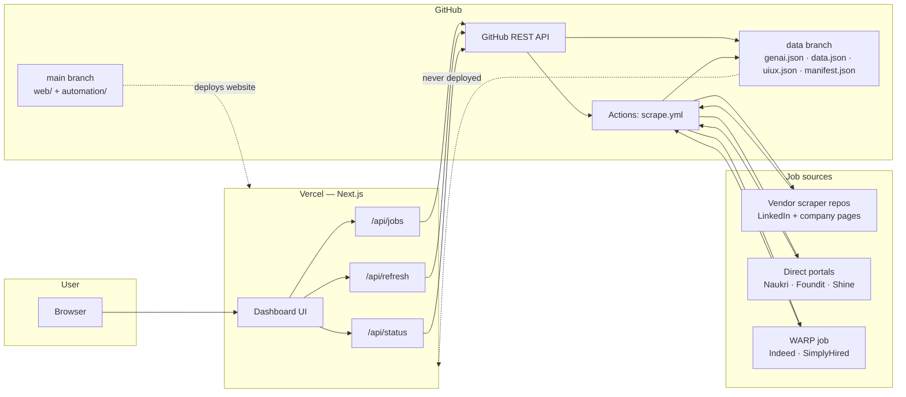
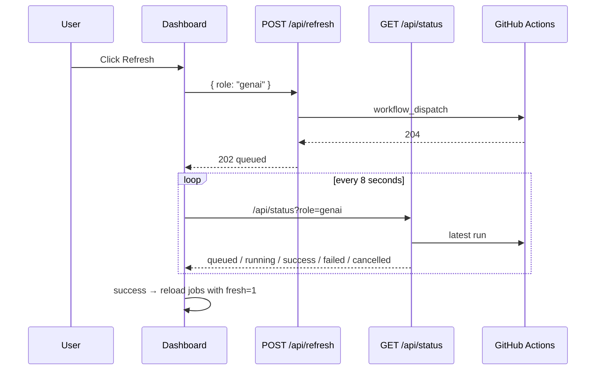

# Architecture — JobHunt Hub

A zero-cost, cloud-only job board for three role tracks:

- **GenAI / AI Engineering**
- **Data Engineering**
- **UI / UX Design**

It aggregates jobs from Naukri, Foundit, Indeed, Shine, LinkedIn and company career pages, publishes them as compact JSON, and serves them through a Next.js app on Vercel.

| Item | Value |
|---|---|
| Live site | <https://jobhunt-hub-web.vercel.app> |
| Repository | <https://github.com/Dilip457/jobhunt-hub> |
| Code branch | `main` |
| Data branch | `data` |
| Schedule | `30 1 * * *` UTC = **07:00 IST** daily |
| Hosting | Vercel (UI + API), GitHub Actions (scraping + publishing) |
| Database | None |
| Cost | ₹0/month on free tiers |

---

## 1. What the system does

1. Every morning, GitHub Actions runs the scraping workflow.
2. Three independent scrapers collect jobs for the three role tracks.
3. The results are merged with the previous published data.
4. The merged JSON is force-pushed to an orphan `data` branch.
5. Vercel serves a Next.js UI and API routes that read that JSON.
6. Users can also press **Refresh** to run the same workflow on demand.

The scraper never runs on Vercel. The website never runs on the user's PC. Everything happens on GitHub's runners and Vercel's servers.

---

## 2. Design goals and non-goals

### Goals

- **Free to operate** — GitHub Actions + Vercel free tiers, no paid domain or database.
- **No PC dependency** — the daily pipeline runs entirely in the cloud.
- **No portal accounts or API keys required** — direct scrapers read public pages.
- **Fast page loads** — the UI reads cached JSON, not live portals.
- **Resilient publishing** — a failed or empty source must not blank the site.
- **Transparent dates** — each card shows when the job was posted on the portal and when this site first scraped it.
- **Single small data artifact** — JSON in the repo, no database.

### Non-goals

- Guaranteed real-time job data.
- Bypassing every anti-bot system permanently.
- Applying to jobs automatically.
- Collecting candidate PII or full job descriptions.
- Commercial use of scraped content.

---

## 3. High-level architecture



### Key separation

| Layer | Runs on | Responsibility |
|---|---|---|
| **UI** | Vercel | Render jobs, filters, role dropdown, refresh panel |
| **API routes** | Vercel | Read JSON, dispatch workflow, poll run status |
| **Scraping** | GitHub Actions | Collect jobs from portals and vendor repos |
| **Publishing** | GitHub Actions | Merge, retain, write, force-push `data` |
| **Storage** | GitHub `data` branch | Compact JSON only |
| **Orchestration** | GitHub Actions | Cron + manual dispatch |
| **Auth** | GitHub PAT (server-side) | Read `data`, dispatch workflow, read run status |

---

## 4. Components

### 4.1 GitHub Actions — `scrape.yml`

The workflow has four job groups:

| Job | Purpose | Timeout | Parallelism |
|---|---|---|---|
| `prepare` | Build the role matrix (`genai`, `data`, `uiux`) | default | one job |
| `scrape` | Run the vendor pipeline + direct portal scrapers per role | 75 min per role | **1 role at a time** (`max-parallel: 1`) |
| `warp` | Run Indeed SEO + SimplyHired through Cloudflare WARP | 12 min per role | **1 role at a time**, `continue-on-error` |
| `publish` | Merge artifacts and force-push the `data` branch | default | one job, `if: always()` |

The `scrape` and `warp` groups both depend only on `prepare`, so GitHub may run them concurrently. Within each group, the roles run sequentially.

### 4.2 Scraper sources

| Source | How it is collected | Runs in |
|---|---|---|
| **LinkedIn** | Vendor repo's guest job search | `scrape` job |
| **Company career pages** | Vendor repo's company registry | `scrape` job |
| **Naukri** | Playwright + real Google Chrome | `scrape` job |
| **Foundit** | Public `/middleware/jobsearch` JSON endpoint | `scrape` job |
| **Shine** | Server-rendered HTML search pages | `scrape` job |
| **Indeed** | `curl_cffi` then Playwright; usually blocked on cloud IPs | `scrape` job (best effort) |
| **Indeed SEO** | Search-engine-style pages through WARP | `warp` job |
| **SimplyHired** | `curl_cffi` through WARP | `warp` job |
| **Optional APIs / ATS** | Adzuna, Jooble, JSearch, Remotive, Himalayas, Greenhouse/Lever/Ashby/SmartRecruiters | Local / opt-in only (`--no-apis` in cloud) |

### 4.3 Publisher — `publish.py`

The publisher is deliberately conservative:

- It reads all artifacts for a role (`<role>.json`, `<role>.warp.json`).
- It merges them with the previous published file.
- It keeps the **highest score** per job.
- It keeps the **earliest `first_seen`** per job.
- It drops jobs older than **21 days**.
- If a role produced no fresh jobs, it keeps the previous JSON.
- It writes one orphan commit and force-pushes it to `data`.

### 4.4 Vercel — Next.js app

The `web/` directory is a Next.js 15 app deployed with **Root Directory = `web`**.

- The dashboard is a client component with a role dropdown and filters.
- `/api/jobs` reads a role's JSON from the `data` branch.
- `/api/refresh` dispatches the GitHub Actions workflow.
- `/api/status` reports the latest workflow run for the role.
- The browser never talks to GitHub directly; all GitHub access is server-side.

### 4.5 GitHub API

Vercel uses a fine-grained PAT with:

- **Actions: read and write** — dispatch the workflow, read run status.
- **Contents: read** — read JSON from the `data` branch.

The token is stored only in Vercel environment variables and is never sent to the browser.

---

## 5. Branch model

```text
main
├─ .github/workflows/scrape.yml
├─ automation/
├─ profiles/
├─ web/
└─ README.md / docs/

data  (orphan, single commit, force-pushed every run)
├─ genai.json
├─ data.json
├─ uiux.json
├─ manifest.json
└─ vercel.json   ← tells Vercel not to deploy this branch
```

| Branch | Contents | Vercel deployment |
|---|---|---|
| `main` | Application code | ✅ Production site |
| `data` | JSON only | ❌ Explicitly disabled |

`publish.py` writes `vercel.json` on the data branch:

```json
{
  "$schema": "https://openapi.vercel.sh/vercel.json",
  "git": { "deploymentEnabled": { "data": false } }
}
```

This prevents Vercel from trying to build the JSON-only branch with Root Directory `web` (which would fail because `web/` does not exist there).

### Why an orphan branch?

- The repository does not grow by ~1 MB per day.
- The data branch always has exactly one commit.
- The main branch history stays clean.
- JSON can be force-pushed without merge conflicts.
- Vercel can be told to ignore the branch entirely.

---

## 6. Daily run sequence


### Timing

- Cron is **01:30 UTC**, which is **07:00 IST**.
- GitHub can delay scheduled workflows by a few minutes under load.
- Scraping is sequential per matrix, so a full run can take a while.
- The publish job runs at the end, once the scrape and WARP jobs finish (or fail).

---

## 7. Data lifecycle

```text
Portal pages
   ↓
Scraper normalization + scoring
   ↓
artifacts/<role>.json
artifacts/<role>.warp.json
   ↓
publish.py
   ├─ merge artifacts for the role
   ├─ merge with previous <role>.json
   ├─ dedupe + retention (21 days)
   └─ write manifest
   ↓
data branch (force-push)
   ↓
Vercel API (60s cache)
   ↓
Browser
```

### Merge rules

- **Identity:** canonical URL, falling back to `title|company|location`.
- **Winner:** the version with the higher `score`.
- **First seen:** the earliest non-null `first_seen` across both versions.
- **Retention:** drop when `posted_date` (or `first_seen` fallback) is older than 21 days.
- **Sort:** score descending, then posted date.
- **Counts:** recomputed from the final job list.

### Role statuses

| Status | Meaning |
|---|---|
| `fresh` | Fresh jobs existed and there was no previous file |
| `merged` | Fresh jobs were merged with previous data |
| `kept-previous` | No usable fresh jobs; previous JSON was kept |
| `missing` | No fresh or previous data for this role |

The status is written to `manifest.json` for diagnostics.

---

## 8. Freshness model

Each card distinguishes two dates:

| Field | Meaning | Source |
|---|---|---|
| `posted_date` | When the portal says the job was posted | Portal / vendor scraper |
| `first_seen` | When **this site** first scraped the job | Scraper run date |

> **Note:** Indeed and SimplyHired currently use the scrape date as `posted_date` because their relative timestamps are not parsed reliably. For those two sources, “Posted” is effectively the scrape date; `first_seen` remains the authoritative first-scrape date.

The card renders:

```text
Posted 3 days ago · First seen today
```

### `first_seen` rules

1. New jobs get `first_seen = today` (UTC date) at scrape time.
2. The publisher keeps the **minimum** `first_seen` across runs.
3. A job that was already known never becomes “newly scraped” again.
4. Legacy data (before this field represented scrape history) used the portal posted date as `first_seen`; keeping the minimum preserves the older listing date rather than relabelling long-known jobs as new.

### Cache behaviour

| Layer | Behaviour |
|---|---|
| Next.js data cache | `revalidate: 60` seconds |
| CDN response | `s-maxage=60, stale-while-revalidate=300` |
| `?fresh=1` | Bypasses caches (`no-store`) |
| `/api/status` | `no-store` |

After a publish, the site may take roughly **1–5 minutes** to show new data unless `fresh=1` is used.

---

## 9. Manual refresh flow



### Guards

| Guard | Result |
|---|---|
| Origin not allowed | `403 Blocked origin` |
| Unknown role | `400 Unknown role` |
| GitHub not configured | `503 Refresh is not configured` |
| A run is queued/running | `409 A scrape is already running` |
| Last run finished < 25 minutes ago | `429 Recently refreshed` |
| Dispatch failed | `502 Could not start the scrape` |
| Dispatch accepted | `202 { ok: true, role, state: "queued" }` |

A **cancelled** run is reported as `cancelled`, not `failed`.

---

## 10. Failure handling

| Failure | Behaviour |
|---|---|
| One portal blocks the runner | That portal returns 0; other sources continue |
| One role's scrape throws | Other roles continue (`fail-fast: false`) |
| A role produces no artifact | Publisher keeps the previous JSON for that role |
| WARP fails or is blocked | WARP job is `continue-on-error`; publish still runs |
| All fresh data missing | Publisher keeps previous files; if none, role is `missing` |
| Publish fails | Previous `data` branch remains untouched |
| Vercel cannot read GitHub | Falls back to seed JSON in `web/data/` |
| A workflow is cancelled | The UI now shows **“Scrape cancelled”**; `publish` may still run because it uses `if: always()` |

### Important cancellation caveat

`publish` uses `if: always()` so a partial run can still publish whatever succeeded. If a run is cancelled **after** `publish` starts, the data branch may be updated with a partial merge. Cancelling a run is safe for the previous data because the publisher merges rather than overwrites, but it can still publish the artifacts that were available.

---

## 11. Security, privacy and cost

### Security

- GitHub PAT is server-side only.
- Refresh endpoint checks the request origin.
- No user accounts, passwords, or personal data.
- No database, so no SQL injection or database credentials.
- Job URLs are opened in a new tab with `rel="noopener noreferrer"`.

### Privacy

- Only public job listings are stored.
- No candidate resumes, profiles, or contact details.
- Full descriptions are not stored; only a ~240-character snippet.
- Foreign listings are filtered out; the board is India + Remote.

### Cost

| Service | Plan | Role |
|---|---|---|
| GitHub Actions | Free minutes | Scraping + publishing |
| GitHub repository | Free | Code + JSON storage |
| Vercel | Hobby | UI + API |
| Cloudflare WARP | Free | Opportunistic exit IP for Indeed/SimplyHired |

No paid domain, database, proxy, or API subscription is required for the core flow.

---

## 12. Known limitations

1. **Indeed is unreliable from cloud IPs.** It frequently returns `403 Security Check` or `401 Authenticating`. The WARP job improves the odds but does not guarantee results. A residential IP or paid proxy would be required for reliability.
2. **Scraping HTML is brittle.** A portal redesign can break a parser until it is updated.
3. **GitHub cron is best-effort.** Scheduled runs can start late, and GitHub may disable schedules for inactive repositories.
4. **Sequential matrix.** `max-parallel: 1` keeps resource usage predictable but makes full runs slower.
5. **Cache lag.** New data can take a few minutes to appear through the CDN.
6. **Legacy `first_seen` values.** Pre-change jobs may show the portal posted date as “first seen” because no earlier scrape history was stored.
7. **Retention is 21 days.** A job that disappears from the portals can remain on the board for up to 21 days.
8. **Terms of service.** Scraping public pages may be restricted by individual portals; this project is intended for personal, non-commercial use.

---

## 13. Key design decisions

| Decision | Why |
|---|---|
| **GitHub Actions instead of a server** | Free, scheduled, no PC, no always-on host |
| **JSON in an orphan `data` branch** | No database, no cost, easy to inspect, atomic force-push |
| **Merge instead of overwrite** | A lighter or partially blocked run must not remove jobs |
| **21-day retention** | Keeps the board useful without growing forever |
| **Next.js API proxy** | Hides the GitHub token and adds caching |
| **Separate WARP job** | Isolates the system-wide tunnel and its failures from the main scrape |
| **Real Chrome for Naukri** | Naukri rejects the bundled headless shell |
| **Earliest `first_seen` wins** | Distinguishes genuinely new jobs from re-scraped old ones |
| **Vercel skip for `data`** | The JSON-only branch has no `web/` app to build |

---

## 14. Related documents

- [Implementation guide](IMPLEMENTATION.md) — file-by-file details, commands, data contract, deployment, troubleshooting.
- [README](../README.md) — project overview and quick start.
