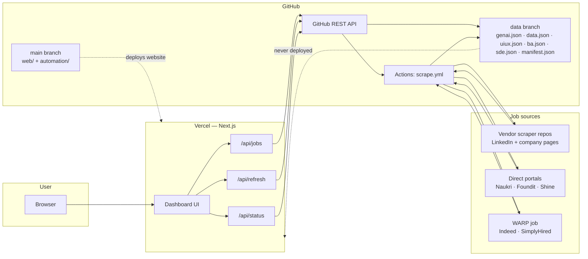
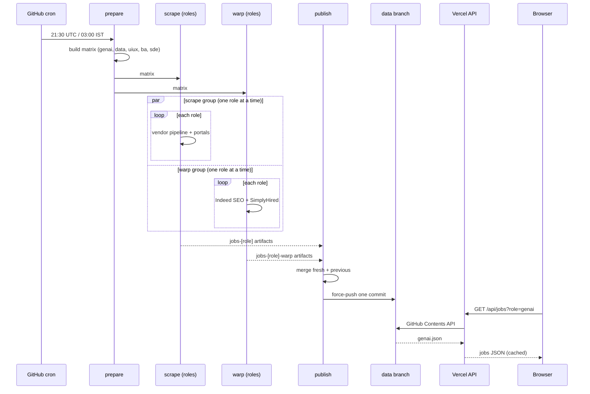
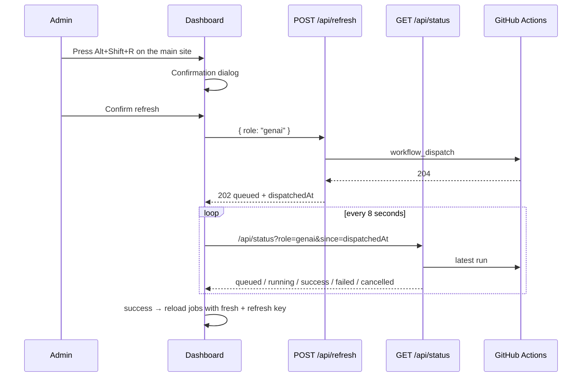

# Architecture — JobHunt Hub

A zero-cost, cloud-only job board for five role tracks:

- **GenAI / AI Engineering**
- **Data Engineering**
- **UI / UX Design**
- **Business Analyst** (entry-level first: fresher and 1–3 year roles rank above senior roles)
- **Software Development Engineer** (3–8 year roles rank first)

It aggregates jobs from Naukri, Foundit, Indeed, Shine, LinkedIn and company career pages, plus BA-specific sources (IIBA Career Center, Wellfound, Remote OK, We Work Remotely), publishes them as compact JSON, and serves them through a Next.js app on Vercel.

| Item | Value |
|---|---|
| Live site | <https://jobhunt-hub-web.vercel.app> |
| Repository | <https://github.com/Dilip457/jobhunt-hub> |
| Code branch | `main` |
| Data branch | `data` |
| Schedule | `30 21 * * *` UTC = **03:00 IST** daily |
| Hosting | Vercel (UI + API), GitHub Actions (scraping + publishing) |
| Database | None |
| Cost | ₹0/month on free tiers |

---

## 1. What the system does

1. Every morning, GitHub Actions runs the scraping workflow.
2. Five independent scrapers collect jobs for the five role tracks. Business Analyst and SDE reuse the UI/UX vendor pipeline with BA config and scoring, and adds its own portal and API sources.
3. The results are merged with the previous published data.
4. The merged JSON is force-pushed to an orphan `data` branch.
5. Vercel serves a Next.js UI and API routes that read that JSON.
6. An admin can reveal a hidden refresh control and run the same workflow on demand.

The scraper never runs on Vercel. The website never runs on the user's PC. Everything happens on GitHub's runners and Vercel's servers.

---

## 2. Design goals and non-goals

### Goals

- **Free to operate** — GitHub Actions + Vercel free tiers, no paid domain or database.
- **No PC dependency** — the daily pipeline runs entirely in the cloud.
- **No portal accounts or API keys required** — direct scrapers read public pages.
- **Fast page loads** — the UI reads cached JSON, not live portals.
- **Resilient publishing** — a failed or empty source must not blank the site.
- **Transparent dates** — each card shows when the job was posted on the portal and when this site first scraped it.
- **Single small data artifact** — JSON in the repo, no database.
- **Accessible by default** — the cinematic intro is optional; skip, reduced-motion, keyboard and WebGL fallbacks all reach the jobs.

### Non-goals

- Guaranteed real-time job data.
- Bypassing every anti-bot system permanently.
- Applying to jobs automatically.
- Collecting candidate PII or full job descriptions.
- Commercial use of scraped content.

---

## 3. High-level architecture



### Key separation

| Layer | Runs on | Responsibility |
|---|---|---|
| **UI** | Vercel | Render the cinematic role selection and job dashboards, filters, refresh panel |
| **API routes** | Vercel | Read JSON, dispatch workflow, poll run status |
| **Scraping** | GitHub Actions | Collect jobs from portals and vendor repos |
| **Publishing** | GitHub Actions | Merge, retain, write, force-push `data` |
| **Storage** | GitHub `data` branch | Compact JSON only |
| **Orchestration** | GitHub Actions | Cron + manual dispatch |
| **Auth** | GitHub PAT (server-side) | Read `data`, dispatch workflow, read run status |

---

## 4. Components

### 4.1 GitHub Actions — `scrape.yml`

The workflow has four job groups:

| Job | Purpose | Timeout | Parallelism |
|---|---|---|---|
| `prepare` | Build the role matrix (`genai`, `data`, `uiux`, `ba`, `sde`) | 5 min | one job |
| `scrape` | Run the vendor pipeline + direct portal scrapers per role | 75 min per role | **all roles at once** (`max-parallel: 5`) |
| `warp` | Run Indeed SEO + SimplyHired through Cloudflare WARP | 12 min per role | **all roles at once**, `continue-on-error` |
| `publish` | Merge artifacts and force-push the `data` branch | 10 min | one job, `if: always()`; the only job with `contents: write` |

The `scrape` and `warp` groups both depend only on `prepare`, so GitHub may run them concurrently. Within each group every role is its own job on its own runner with its own vendor checkout, so the matrix runs them all in parallel — the run costs the *slowest* role rather than the sum. Both groups used to be `max-parallel: 1`, which serialised them.

### 4.1.1 Concurrency inside a role

Two levels, and they multiply:

1. **Across roles** — the matrix above. Five roles that each took ~14 minutes now overlap instead of queueing.
2. **Across sources within a role** — the vendor's `_run_scrapers` walks its sources one at a time, so a role with ten portals paid the sum of their latencies. `run_source.py` replaces it (`_patch_parallel_scrapers`) with a bounded `ThreadPoolExecutor`, default 4, tunable with `--parallel-sources N` (`1` disables it and leaves the vendor loop untouched).
3. **Portal scraping overlaps the vendor pipeline** — `run_source.py` starts `collect_portal_jobs` in a background thread *before* `pipeline.run()` and joins it after export. The direct portal scrapers (Naukri, Shine, Foundit, IIBA, Wellfound) and the vendor sources (LinkedIn, company pages) touch different domains and share no state, so the slowest phase sets the role's wall clock instead of the sum. `collect_portal_jobs(..., parallel=N)` / `--parallel-portals N` runs the portal sources themselves concurrently; CI passes `4`. Results are still merged in registry order, so output is stable between sequential and parallel runs.
4. **Indeed is left to the WARP job** — the `scrape` job sets `INDEED_HTTP_ONLY=1`, so the fast `curl_cffi` path runs but a headed browser fallback is skipped. The dedicated `warp` job retries Indeed and SimplyHired through a clean exit IP; a browser fallback in `scrape` would spend minutes for the same inventory.

The scrapers are I/O bound and each source is a different domain, so threads are the right shape and no single host sees stacked requests. Each worker gets its own scraper instance and a *snapshot* of the existing-data sets, so nothing is shared mutably between threads; results are merged afterwards in registry order and de-duplicated by URL, which is what the sequential loop achieved by mutating the shared sets inline. A failing source is caught, logged and counted exactly as before.

URL validation is already skipped in CI (`--no-validate`), so the remaining cost inside a role is the scrape itself.

### 4.2 Scraper sources

| Source | How it is collected | Runs in |
|---|---|---|
| **LinkedIn** | Vendor repo's guest job search | `scrape` job |
| **Company career pages** | Vendor repo's company registry | `scrape` job |
| **Naukri** | Playwright + real Google Chrome | `scrape` job |
| **Foundit** | Public `/middleware/jobsearch` JSON endpoint | `scrape` job |
| **Shine** | Server-rendered HTML search pages | `scrape` job |
| **Indeed** | `curl_cffi` then Playwright; usually blocked on cloud IPs | `scrape` job (best effort) |
| **Indeed SEO** | Search-engine-style pages through WARP | `warp` job |
| **SimplyHired** | `curl_cffi` through WARP | `warp` job |
| **Company career boards** | Workday/Greenhouse/Lever/Ashby/SmartRecruiters job feeds for ~240 companies (`companies.json`) | `scrape` job's extra-sources step, every role; `--no-apis` in the main scrape |
| **Keyless remote feeds** | Remotive, Himalayas, Remote OK, We Work Remotely | `scrape` job's extra-sources step (BA, SDE) |
| **IIBA Career Center** | Server-rendered search page (plain HTTP) | `scrape` job (BA only) |
| **Wellfound** | Embedded Apollo state in the role page | `scrape` job (BA only) |
| **Remote OK** | Public remote jobs API | BA API step |
| **We Work Remotely** | Public RSS feed | BA API step |

### 4.2.1 Business Analyst track

Business Analyst has no separate vendor repo. It reuses `Dilip457/UI-UX-Job_Hunt`, and
`run_source.py` patches that repo before its modules import:

- `config.SEARCH_KEYWORDS`, `SKILL_SEARCH_KEYWORDS` and `TARGET_ROLES` from `profiles/ba.json`
- `config.RESUME_PROFILE`, high/medium weight keywords and the role/tool scoring functions
- `scrapers.company_pages_scraper.DESIGN_KEYWORDS`, so BA titles survive its title filter

`api_sources.py` and `export.py` apply an **entry-level-first** score adjustment for `ba`:
fresher, entry-level, graduate, intern, junior, associate and 1–3 year titles get a boost;
senior, lead, principal, manager, director and head titles are pushed down. The dashboard
(`web/lib/utils.ts` → `experiencePriority()`) applies the same order when the role is `ba`
and the sort is `score`.

BA-only portal scrapers live in `portal_scrapers.py` (`iiba`, `wellfound`) and run inside the
normal `scrape` job. The workflow's `api_sources.py` step (company boards for every role,
remote feeds for `ba` and `sde`) writes `artifacts/ba.apis.json`;
`publish.py` merges every `ba*.json` artifact.

### 4.2.2 Software Development Engineer track

SDE follows the same pattern as BA and reuses `Dilip457/UI-UX-Job_Hunt`, so adding it needed
no new vendor repo and no new scraper. `run_source.py` patches that repo before its modules
import:

- `config.SEARCH_KEYWORDS`, `SKILL_SEARCH_KEYWORDS` and `TARGET_ROLES` from `profiles/sde.json`
- `config.RESUME_PROFILE`, high/medium weight keywords and the role/tool scoring functions
  (`_patch_sde_scoring`), pointing them at the `SDE_*` tables
- `scrapers.company_pages_scraper.DESIGN_KEYWORDS`, so SDE titles survive its title filter

The role tables live in `run_source.py` (`SDE_RESUME_PROFILE`, `SDE_ROLE_KEYWORDS`, …) and are
registered in `ROLE_RESUME_PROFILES`, `ROLE_HIGH_WEIGHT`, `ROLE_MEDIUM_WEIGHT`,
`ROLE_KEYWORD_TABLES` and `ROLE_COMPANY_TITLE_KEYWORDS`. Adding another role to the shared
pipeline means adding a table and one entry per registry — the patch functions are
role-agnostic and do not branch on the slug.

SDE is a **3–8 year track**, not an entry-level one, so it gets its own experience band
instead of BA's entry-level-first boost. `SDE_EXPERIENCE_BAND = (3, 8)` is applied in three
places so the whole pipeline agrees on the band:

- `run_source.py` overrides `ScoringEngine._score_experience_match` with an overlap score.
  The vendor version centred on one years figure, which pushed the top of the band (7–8
  years) down as if over-qualified; the override scores the overlap with 3–8 instead.
- `export.py` (`sde_band_score`) nudges the published score: squarely in band +8, strong
  overlap +6, partial +3, entry-level −12, clearly too senior −10. Because the dashboard
  sorts by score by default, this is what surfaces 3–8 year roles first.
- `api_sources.py` (`sde_band_adjust`) applies the same shape to the keyless feeds.

Titles are the fallback when a listing states no range: senior/lead/SDE-II/III up, principal/
architect/director/VP down, fresher/intern/junior down. `web/lib/utils.ts`
(`experienceBandPriority`) mirrors the same bands for the dashboard's `score` sort when the
role is `sde`, the way `experiencePriority` does for `ba`.

`api_sources.py` carries `sde` entries in `ROLE_SEARCH_TERMS`, `ROLE_TITLE_TOKENS`,
`ROLE_TITLE_EXCLUDE` and `ROLE_SKILLS`, and the workflow's remote feeds run for both
`ba` and `sde`, writing `artifacts/sde.apis.json`. `publish.py` merges every `sde*.json`
artifact. `profiles/sde.json` asks for the whole vendor registry — `company_pages`, `linkedin`,
`naukri`, `indeed`, `foundit`, `shine`, `timesjobs`, `wellfound`, `instahyre`, `glassdoor` —
where BA and UI/UX run two sources; `run_source.py` drops any name the vendor does not
register, so this list can safely stay ahead of the vendor.

### 4.3 Publisher — `publish.py`

The publisher is deliberately conservative:

- It reads all artifacts for a role (`<role>.json`, `<role>.warp.json`).
- It merges them with the previous published file.
- It keeps the **highest score** per job.
- It keeps the **earliest `first_seen`** per job.
- It drops jobs older than **21 days**.
- It re-checks every job title against the current role rules (`title_relevant`), including carried-over jobs.
- If a role produced no fresh jobs, it keeps the previous JSON.
- It writes one orphan commit and force-pushes it to `data`.

### 4.4 Vercel — Next.js app

The `web/` directory is a Next.js 16 app deployed with **Root Directory = `web`**.

- `/` is the cinematic entry point: a Three.js close-up greeting, pullback, illuminated path and role selection.
- `/jobs/genai`, `/jobs/data`, `/jobs/uiux`, `/jobs/ba` and `/jobs/sde` are static, shareable dashboards.
- `/jobs/[role]` is pre-rendered for the five known roles; any other slug redirects to `/`.
- The dashboard is a client component with filters, a role switcher, numbered pages of 8 jobs and shareable query parameters (including `page`).
- It opens with what changed and what is best, before the list: a ticker of jobs new since the last scrape, the role's gate beside the title, the best match as a solid tile, and how that match earns its score (a radar of its `score_parts`: role fit, skills, tools, and experience fit for BA and SDE) next to the role's jobs by match band. All of it is computed in the browser from the one role file the page already loads; nothing extra is fetched. When the file carries fewer than three parts (files from before the parts existed, or before the tools part was split out), the browser reads the same parts from the listing with a copy of the scraper's rules (`web/lib/estimate.ts`) and says so under the bars. The role's colour also runs down both edges of the page as a thin fixed light, the gate's strip carried over from the intro.
- `/api/jobs` reads a role's JSON from the `data` branch.
- `/api/refresh` dispatches the GitHub Actions workflow.
- `/api/status` reports the latest workflow run for the role.
- The browser never talks to GitHub directly; all GitHub access is server-side.

### 4.5 Front-end experience and graceful degradation

The cinematic intro is progressive enhancement, never a gate:

| Condition | Behaviour |
|---|---|
| Normal visit | Clean boot, then a four-second rigged 3D character close-up (`HI.`), camera pullback, path, turn, walk, role selection |
| Returning visitor | The greeting still plays; **Skip intro** jumps straight to role selection |
| **Skip intro** | Cancels timers and jumps straight to role selection |
| `prefers-reduced-motion: reduce` | Static wide-scene selector: four-second `HI.` first, then the same five destinations; no canvas |
| WebGL unavailable, model fails, or a 12 s load timeout | The same static wide-scene fallback; the greeting is shown before the role cards |
| Very small screen | Aspect- and height-aware camera, gate-fitting departure shot, scrollable compact bottom sheet; short landscape uses a three-column strip |
| Browser back/forward | Standard App Router history between `/` and `/jobs/[role]` |

The 3D character is a stylized, rigged CC0 **“Casual Man”** base by Grab3D, simplified
from 244,257 to 85,487 triangles, with 1024px WebP textures, flat navy fabric, flat brown
hair, a cleaned basecolour and a generated breathing idle. The material is uniformly matte
(no roughness/metallic maps) to remove specular flecks, and the earlier runtime glasses are
gone. The destination gates stay hidden during the close-up and fade into the world with
the pullback. The loading boot and static fallback use a wide scene poster (`scene.webp`),
not a full-screen face crop. The camera is aspect- and height-aware: portrait phones use a
wider vertical lens and a centred stage, while the departure shot pulls back until the
selected gate's full width and height fit. This keeps the gate and its surroundings visible
while the guide walks, instead of cropping a pillar or the arch on a narrow screen. The
role sheet scrolls when needed and becomes a compact three-column strip in short landscape.
The character has no facial blendshapes, eye rig, lip-sync or motion capture;
the source ships only walk and run clips. The dashboard states this and the full
modification record ships in `web/public/models/student/ATTRIBUTION.txt`.

The shared brand mark is "Next Step" (`BrandMark.tsx`): three isometric steps in
CSS 3D, the top one in blue, with a red dot that hops from step to step, rests on
the top, fades and starts again every 3.6 s. It carries the site's line, "find your
next move". The boot screen stays cheap because the effect uses CSS transforms
rather than a second WebGL context. Everything is sized in em from the mark's
font-size, 42px on desktop and 36px on phones, and under reduced motion the dot
rests on the top step.

The tab icon is the same mark: the same three steps and red dot, outlined in ink so
it reads on light and dark tab strips, in `web/public/favicon.svg` with PNG and ICO
sizes rendered from it. The PWA and Apple icons put it on the site's dark ground
inside the maskable safe zone.
Chromium does not animate SVG favicons, so `AnimatedFavicon.tsx` paints a 64×64
frame to a canvas at 8 fps and points every `rel="icon"` link at the resulting PNG.
Each frame costs main-thread time (a PNG encode and the browser's icon update), so
the animation stands down whenever that time matters more: while the cinematic
scene is drawing (`CinematicIntro` sets `data-scene-busy` on `<html>`) and for
400 ms after any scroll or pointer input. It also pauses while the tab is hidden and
is skipped under `prefers-reduced-motion: reduce`, where the static SVG, ICO and PNG
files in `web/public/` remain. Icon URLs carry a `?v=7` suffix so a browser that cached an
older tab icon picks up the new one.

### 4.5.1 Frame budget

The intro is drawn every frame, so everything that runs per frame is kept inside a
budget an integrated GPU can meet:

- **Render resolution.** `web/lib/renderQuality.ts` (`createQualityGovernor`) owns the
  canvas pixel ratio. It starts at the display's own ratio, capped at 1.5, and every
  30 frames compares the mean frame time with a 24 ms / 13 ms band: too slow and the
  ratio steps down 0.15 (never below 0.7); comfortably fast for 3 s and it steps back
  up 0.1 (never above the start). Before this the scene supersampled every display to
  at least 2×, which held an Intel UHD 630 at about 10 fps.
- **Lights.** Three directional (key, rim, fill) and four point lights (red, blue,
  face fill, gate spill). Each gate's floor light is its additive glow plane, not a
  point light, because every light is evaluated for every lit fragment. The gate
  spill is one short-range (1.8 m) light shared by all five gates: during the walk it
  rides just above the guide's crown, leaning toward the selected gate, in that
  gate's colour, and brightens as he nears it. It sits at zero intensity otherwise
  rather than being removed, because changing the light count recompiles every lit
  material.
- **Shadows.** One 1024 px `PCFShadowMap` from the key light. The character is the
  only caster, so the shadow camera is a 7 m box that follows him (`updateCharacter`
  moves the light and its target), which is sharper than the old 24 m, 2048 px soft
  map and a quarter of the work.
- **Materials.** Floor, runway and gate frames are `MeshStandardMaterial`; the
  physical material's extra lobes were paid on every floor fragment.
- **Overlays.** Nothing drawn over the canvas uses `filter: blur()` or
  `backdrop-filter`: the ambient discs are radial gradients and the role dock, cards
  and pills are near-opaque panels. A blur on a composited layer, or a backdrop blur
  over a canvas that redraws every frame, is recomputed by the compositor every frame.

The dashboard follows the same rule for scrolling: the sticky header has no backdrop
blur and holds only the brand, role switcher and actions (the updates ticker sits below it and the filter bar further down, and both scroll with the page, so neither rides over the content), the fixed background glows are gradients rather than blurred
discs, the below-the-fold info section uses `content-visibility: auto`, and the
search box feeds the job filter through `useDeferredValue`, so keystrokes never wait
for the list. Its own motion is transform and opacity only: the gate beside the title
(`HeroGate`) and the radar in the match-signal panel turn on CSS keyframes; the
updates ticker is one translating track that pauses under the pointer; each job card
takes a colour of its company's own from `companyHue()` (a hash of the name, so the
same company always gets the same hue), set as `--hue`, `--hue-ink` and `--hue-text`
custom properties for the wordmark, the corner bloom, the New chip and Apply's hover
fill, with the text tone lightened until it reads at 4.5:1 and the ink on the fill
chosen by contrast; a job card is
two faces in one grid cell inside a `preserve-3d` box: the role colour lights where
the pointer lands (a separate layer, opacity only) and after 1.2 s `JobCard` adds
`.is-flipped`, which turns the box `rotateY(180deg)` over 0.7 s to the back face
(the listing's words, the score's parts as bars that grow once the back shows,
company · city, Apply); the face that is away is `inert`, so Apply is one tab stop.
The hover turn runs only on a pointer that can hover with motion not reduced
(`JobCard` checks the media query once). On every device a click or tap anywhere on
the card except a link or button toggles the flip and cancels a pending hover turn;
the card is focusable and Enter or Space does the same. Under
`prefers-reduced-motion: reduce` the ticker stands still and scrolls, the gate, radar
and edge lights hold, the light is off, and a click turns the card with no transition.

### 4.6 GitHub API

Vercel uses a fine-grained PAT with:

- **Actions: read and write** — dispatch the workflow, read run status.
- **Contents: read** — read JSON from the `data` branch.

The token is stored only in Vercel environment variables and is never sent to the browser.

---

## 5. Branch model

```text
main
├─ .github/workflows/scrape.yml
├─ automation/
├─ profiles/
├─ web/
└─ README.md / docs/

data  (orphan, single commit, force-pushed every run)
├─ genai.json
├─ data.json
├─ uiux.json
├─ ba.json
├─ manifest.json
└─ vercel.json   ← tells Vercel not to deploy this branch
```

| Branch | Contents | Vercel deployment |
|---|---|---|
| `main` | Application code | ✅ Production site |
| `data` | JSON only | ❌ Explicitly disabled |

`publish.py` writes `vercel.json` on the data branch:

```json
{
  "$schema": "https://openapi.vercel.sh/vercel.json",
  "git": { "deploymentEnabled": { "data": false } }
}
```

This prevents Vercel from trying to build the JSON-only branch with Root Directory `web` (which would fail because `web/` does not exist there).

### Why an orphan branch?

- The repository does not grow by ~1 MB per day.
- The data branch always has exactly one commit.
- The main branch history stays clean.
- JSON can be force-pushed without merge conflicts.
- Vercel can be told to ignore the branch entirely.

---

## 6. Daily run sequence



### Timing

- Cron is **21:30 UTC**, which is **03:00 IST** (the previous UTC day).
- The earlier start deliberately gives a buffer for GitHub's best-effort scheduler. A multi-hour delay can still leave the published data ready before the typical morning check.
- GitHub cron is best-effort: scheduled runs can start minutes or occasionally hours late under load, and GitHub can disable schedules after prolonged repository inactivity. If a morning update is late, dispatch the workflow manually or use the hidden dashboard refresh.
- Scraping is sequential per matrix, so a full run can take a while.
- The publish job runs at the end, once the scrape and WARP jobs finish (or fail).

---

## 7. Data lifecycle

```text
Portal pages
   ↓
Scraper normalization + scoring
   ↓
artifacts/<role>.json
artifacts/<role>.warp.json
   ↓
publish.py
   ├─ merge artifacts for the role
   ├─ merge with previous <role>.json
   ├─ dedupe + retention (21 days)
   └─ write manifest
   ↓
data branch (force-push)
   ↓
Vercel API (60s cache)
   ↓
Browser
```

### Merge rules

- **Identity:** canonical URL, falling back to `title|company|location`.
- **Winner:** the version with the higher `score`.
- **First seen / posted date:** the earliest non-null value across both versions; `posted_date` is capped at `first_seen`.
- **Retention:** drop when `posted_date` (or `first_seen` fallback) is older than 21 days; `posted_date` is capped at `first_seen` before this check. A job the fresh scrape lists with no posted date is not aged out by `first_seen` (that is only our first sighting; dropping it would bring it straight back as NEW); it leaves once the board stops listing it.
- **Sort:** score descending, then posted date.
- **Counts:** recomputed from the final job list.

### Role statuses

| Status | Meaning |
|---|---|
| `fresh` | Fresh jobs existed and there was no previous file |
| `merged` | Fresh jobs were merged with previous data |
| `kept-previous` | No usable fresh jobs; previous JSON was kept, minus jobs past the retention window (unseen-days pruning is skipped because a failed scrape says nothing about which jobs closed) |
| `missing` | No fresh or previous data for this role |

The status is written to `manifest.json` for diagnostics.

---

## 8. Freshness model

Each card distinguishes two dates:

| Field | Meaning | Source |
|---|---|---|
| `posted_date` | When the portal says the job was posted | Portal / vendor scraper |
| `first_seen` | When **this site** first scraped the job | Scraper run date |

> **Note:** Indeed and SimplyHired dates come from the card's age stamp (“Posted 3 days ago”, “30d+”); cards without one have `posted_date: null` and the card shows only “First seen”. The publisher keeps the earliest known `posted_date` and caps it at `first_seen`, so a re-dated listing never looks new again.

The card renders:

```text
Posted 3 days ago · First seen today
```

### `first_seen` rules

1. New jobs get `first_seen = today` (UTC date) at scrape time.
2. The publisher keeps the **minimum** `first_seen` across runs.
3. A job that was already known never becomes “newly scraped” again.
4. Legacy data (before this field represented scrape history) used the portal posted date as `first_seen`; keeping the minimum preserves the older listing date rather than relabelling long-known jobs as new.

### Cache behaviour

| Layer | Behaviour |
|---|---|
| GitHub read for role jobs | In memory per server instance for 60 s (15 s after a seed fallback); not the Next.js data cache |
| CDN response | `s-maxage=60, stale-while-revalidate=300` |
| `?fresh=…` | Always `private, no-store`; skips the in-memory read only with a valid `x-refresh-token` |
| `/api/status` | `no-store`; the Actions runs listing is cached in memory for 5 s and shared by every role |

After a publish, the edge may serve the previous response for up to about **5 minutes**, and a server instance may hold the previous read for up to 60 s. The admin's reload after a refresh sends `fresh` with the refresh key, which bypasses both and replaces the cached read. Without the key `fresh` is ignored, so it cannot be used to spend the GitHub API quota.

---

## 9. Manual refresh flow

The refresh control is not rendered anywhere on the site. There is no separate admin URL
and no visible refresh button. On any dashboard, press **`Alt` + `Shift` + `R`**
to open a confirmation dialog; only **Confirm refresh** dispatches the workflow. The
shortcut is ignored while focus is inside a form field, and `Escape` closes the dialog.

The dialog asks for the refresh password: `REFRESH_TOKEN`, any password or PIN the owner
chooses (a long random value is advised), set only in Vercel's environment variables;
changing it needs a redeploy. The dialog is a real sign-in form, so the browser can save the
password and sync it to the owner's other devices; "Remember on this device", off by default,
also keeps it in `localStorage`. A wrong password keeps the dialog open with "Wrong password".



Each role has its own shareable URL — `/jobs/genai`, `/jobs/data`, `/jobs/uiux` and
`/jobs/ba`, `/jobs/sde`. The homepage `/` stays clean; choosing a destination navigates to the role
route. Filter parameters (`q`, `city`, `source`, `score`, `exp`, `days`, `sort`) are written
to the role URL so a filtered view can be shared. Unknown role slugs redirect to `/`.

### Guards

| Guard | Result |
|---|---|
| Origin not allowed | `403 Blocked origin` |
| Missing or wrong password | `401` (wrong ones answered after ~750 ms) |
| 5 wrong passwords from one IP in 15 min, or over 30 from all IPs | `429 too_many_attempts` for 15 minutes, even with the right password |
| Unknown role | `400 Unknown role` |
| GitHub not configured | `503 Refresh is not configured` |
| A run is queued/running | `409 A scrape is already running` |
| Last run finished < 25 minutes ago | `429 Recently refreshed` |
| Dispatch failed | `502 Could not start the scrape` |
| Dispatch accepted | `202 { ok: true, role, state: "queued" }` |

A **cancelled** run is reported as `cancelled`, not `failed`.

Hiding the button is a UX guard, not authentication. `REFRESH_TOKEN` is the access control
(a production build without it refuses every refresh), and the wrong-password lockout keeps a
short password from being brute-forced. The lockout counters live in the server instance's
memory, so they are best effort; the cooldown and one-run-per-role concurrency still bound use.

---

## 10. Failure handling

| Failure | Behaviour |
|---|---|
| One portal blocks the runner | That portal returns 0; other sources continue |
| One role's scrape throws | Other roles continue (`fail-fast: false`) |
| A role produces no artifact | Publisher keeps the previous JSON for that role |
| WARP fails or is blocked | WARP job is `continue-on-error`; publish still runs |
| All fresh data missing | Publisher keeps previous files; if none, role is `missing` |
| Publish fails | Previous `data` branch remains untouched |
| Vercel cannot read GitHub | Falls back to seed JSON in `web/data/` |
| A workflow is cancelled | The UI now shows **“Scrape cancelled”**; `publish` may still run because it uses `if: always()` |

### Important cancellation caveat

`publish` uses `if: always()` so a partial run can still publish whatever succeeded. If a run is cancelled **after** `publish` starts, the data branch may be updated with a partial merge. Cancelling a run is safe for the previous data because the publisher merges rather than overwrites, but it can still publish the artifacts that were available.

---

## 11. Security, privacy and cost

### Security

- GitHub PAT is server-side only.
- Refresh endpoint checks the request origin and the owner's refresh password, with a wrong-password lockout. The password is compared through SHA-256 digests in constant time, so neither timing nor an early length check reveals it. IPv6 clients are counted per /64.
- No user accounts, cookies, or personal data from visitors.
- No database, so no SQL injection or database credentials.
- Response headers on every route (`web/securityHeaders.mjs`): a Content Security Policy, HSTS, `nosniff`, `X-Frame-Options: DENY`, a referrer policy, a permissions policy and same-origin opener and resource policies. The CSP allows no script, connection or frame from another origin and stops other sites framing the page. It keeps `script-src 'unsafe-inline'` because Next.js inlines bootstrap scripts into static pages and a nonce would make every page render per request; the site renders no third-party HTML, so nothing can inject into it today.
- Job links are scraped, so they are treated as untrusted at three points: `publish.py` refuses to publish anything but a plain http(s) link with a host and no `user:password@`, `service.ts` filters the same way when reading the data branch, and the components link through `jobHref()`. They open in a new tab with `rel="noopener noreferrer"`. Text is only ever rendered by React as text; the app has no `dangerouslySetInnerHTML`.
- Fake listings are a social-engineering risk this site cannot fully remove. `publish.py` drops listings that demand a fee (registration, processing, training and similar) and links through URL shorteners or chat apps, and the dashboard tells visitors never to pay to apply. It cannot recognise a well-made fake posted on a real board.
- `/api/status` is public, so upstream error text goes to the server log only, and visitors see a generic message.
- CI and supply chain: workflow actions are pinned to commit SHAs and kept current by Dependabot; tokens are read-only except in the `publish` job, which runs no third-party code and treats artifacts as data; CI fails on high-severity advisories in production npm packages and on any known advisory in the Python packages. Python minimums in `automation/requirements.txt` also lift older versions pinned by vendor repos.
- `enrich_experience.py` reads posting pages from scraped links, so it refuses local and private addresses, including after a redirect.
- Account and hosting settings live outside the repo: see the owner's checklist in [SECURITY.md](../SECURITY.md).

### Privacy

- Only public job listings are stored.
- No candidate resumes, profiles, or contact details. Emails and Indian phone numbers in a listing's snippet are replaced at publish time.
- Full descriptions are not stored; only a ~240-character snippet.
- Foreign listings are filtered out; the board is India + Remote.

### Cost

| Service | Plan | Role |
|---|---|---|
| GitHub Actions | Free minutes | Scraping + publishing |
| GitHub repository | Free | Code + JSON storage |
| Vercel | Hobby | UI + API |
| Cloudflare WARP | Free | Opportunistic exit IP for Indeed/SimplyHired |

No paid domain, database, proxy, or API subscription is required for the core flow.

---

## 12. Known limitations

1. **Indeed is unreliable from cloud IPs.** It frequently returns `403 Security Check` or `401 Authenticating`. The WARP job improves the odds but does not guarantee results. A residential IP or paid proxy would be required for reliability.
2. **Scraping HTML is brittle.** A portal redesign can break a parser until it is updated.
3. **GitHub cron is best-effort.** The schedule starts at 03:00 IST to absorb typical delays, but runs can still start late or be dropped, and GitHub may disable schedules for inactive repositories.
4. **Concurrency has a politeness ceiling.** Roles run in parallel and each role scrapes up to `--parallel-sources` sources at once, which is what keeps a full run inside the job timeout. Push either number higher and the portals may rate-limit or block the runner IPs; the throttles are `max-parallel` in `scrape.yml` and `--parallel-sources` on `run_source.py`.
5. **Cache lag.** New data can take a few minutes to appear through the CDN.
6. **Legacy `first_seen` values.** Pre-change jobs may show the portal posted date as “first seen” because no earlier scrape history was stored.
7. **Retention is 21 days.** A job that disappears from the portals can remain on the board for up to 21 days.
8. **Terms of service.** Scraping public pages may be restricted by individual portals; this project is intended for personal, non-commercial use.
9. **The 3D guide is a prototype.** The rigged character is a stylized CC0 base (a bearded adult in a blue bomber over a white crew-neck tee and navy jeans) with no facial blendshapes, eye rig, lip-sync or motion capture. Its walk/run clips are the only shipped animation, and the close-up is staged to avoid uncanny detail the asset cannot support. The scrambled garment atlas is replaced at runtime by clean blue clothing groups, with the t-shirt panel and collar skin band masked per fragment across the body materials, while the head, hair, hands and sneakers keep the original texture; it is still a modified stock asset, not a bespoke character.
10. **The cinematic is not required.** Reduced-motion, WebGL failure and model failure all fall back to a static selector; jobs are never blocked behind the animation.

---

## 13. Key design decisions

| Decision | Why |
|---|---|
| **GitHub Actions instead of a server** | Free, scheduled, no PC, no always-on host |
| **JSON in an orphan `data` branch** | No database, no cost, easy to inspect, atomic force-push |
| **Merge instead of overwrite** | A lighter or partially blocked run must not remove jobs |
| **21-day retention** | Keeps the board useful without growing forever |
| **Next.js API proxy** | Hides the GitHub token and adds caching |
| **Separate WARP job** | Isolates the system-wide tunnel and its failures from the main scrape |
| **Real Chrome for Naukri** | Naukri rejects the bundled headless shell |
| **Earliest `first_seen` wins** | Distinguishes genuinely new jobs from re-scraped old ones |
| **Role URLs instead of a query parameter** | Shareable destinations, pre-rendered pages and clean browser history |
| **Cinematic intro as progressive enhancement** | A strong first impression without blocking reduced-motion, low-end or keyboard users |
| **Stylized CC0 rigged guide** | A real rigged character for the cinematic while keeping the asset license and prototype limits honest |
| **Vercel skip for `data`** | The JSON-only branch has no `web/` app to build |

---

## 14. Related documents

- [Implementation guide](IMPLEMENTATION.md) — file-by-file details, commands, data contract, deployment, troubleshooting.
- [Code map](CODE_MAP.md) — every action, flow, component and data item mapped to its file and code path.
- [README](../README.md) — project overview and quick start.
